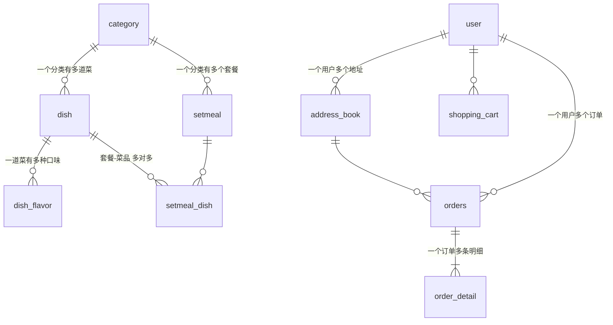

# 表结构说明（迷你外卖库）

和苍穹外卖的表结构基本一致，删掉了图片、口味以外的一些细节字段。完整建表语句见 [sql/schema.sql](../sql/schema.sql)。

## 关系图



用文字说：

```
category ──< dish ──< dish_flavor          （──< 表示一对多）
    │         │
    └──< setmeal ──< setmeal_dish >── dish  （套餐和菜品多对多）

user ──< address_book
  ├──< shopping_cart        （dish_id 或 setmeal_id 二选一）
  └──< orders ──< order_detail（dish_id 或 setmeal_id 二选一）
```

## 每张表

| 表 | 作用 | 关键字段 |
|---|---|---|
| `employee` | 后台员工账号 | `username` 唯一；`status` 1启用 0禁用 |
| `category` | 分类 | `type` 1菜品分类 2套餐分类；`sort` 排序；`status` 1启用 0禁用 |
| `dish` | 菜品 | `category_id` → category；`price` DECIMAL；`status` 1起售 0停售 |
| `dish_flavor` | 菜品口味 | `dish_id` → dish；`value` 是逗号分隔的可选值 |
| `setmeal` | 套餐 | `category_id` → category（type=2 的分类） |
| `setmeal_dish` | 套餐包含的菜品（中间表） | `setmeal_id`、`dish_id`、`copies` 份数 |
| `user` | C 端用户 | `create_time` 注册时间（用户统计用） |
| `address_book` | 收货地址 | `user_id` → user；`is_default` 是否默认地址 |
| `shopping_cart` | 购物车 | `user_id`；`dish_id` / `setmeal_id` 二选一；`amount` 单价；`number` 数量 |
| `orders` | 订单 | `status`：1待付款 2待接单 3已接单 4派送中 5已完成 6已取消；`order_time` 下单时间；`amount` 金额 |
| `order_detail` | 订单明细 | `order_id` → orders；`name`、`amount`（单价）是下单时的**快照**，菜品改名改价也不影响历史订单 |

## 示例数据速览

- **分类 7 个**：热菜、凉菜、主食、饮品、汤羹（禁用，没有菜）、超值套餐（套餐分类）、甜品（没有菜）
- **菜品 20 道**：其中回锅肉、凉拌木耳、柠檬茶 3 道停售
- **套餐 3 个**：单人工作餐、双人套餐、回锅肉套餐（停售，含停售菜品）
- **用户 8 个**：郑十从没下过单；吴九没有手机号；周八没有默认地址
- **订单 28 个**：2024-04-28 ~ 2024-05-08，**2024-05-04 一单都没有**；各种状态都有
- **购物车**：用户 1（宫保鸡丁 ×1、米饭 ×2）、用户 3（单人工作餐 ×1）、用户 8（可乐 ×3）

这些“特殊情况”都是故意设计的，很多题目就是在考你能不能处理好它们。
